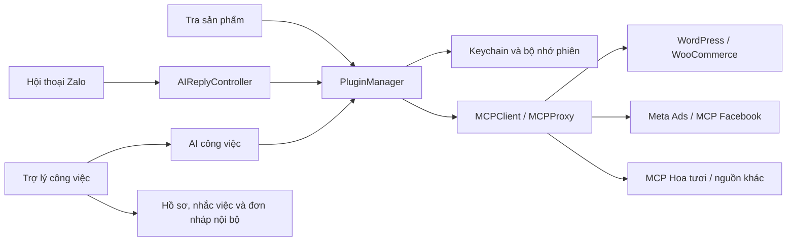

# Olaz — Đặc tả phát triển trợ lý công việc

Ngày lập: 08/11/2026. Ngôn ngữ sản phẩm: tiếng Việt. Nền tảng: macOS, SwiftUI.

## 1. Mục tiêu và phạm vi

Biến Olaz thành nơi xử lý công việc từ hội thoại: tìm thông tin qua MCP, tư vấn sản phẩm, chuẩn bị báo giá, ghi nhớ khách hàng, theo dõi việc cần làm và lập đơn nháp. Chủ tài khoản có thể trao đổi trực tiếp với trợ lý; việc thử AI không cần gửi tin Zalo.

Các nguồn ưu tiên: MCP tùy chỉnh như Hoa tươi; WordPress; WooCommerce; Meta Ads; MCP do người dùng cung cấp cho Fanpage/Messenger. Mỗi nguồn được cấu hình và cấp quyền riêng. Có kết nối trong danh sách chưa đồng nghĩa đã xác thực, tải được công cụ hoặc AI đã dùng nguồn đó.

Cập nhật theo phản hồi người dùng: website ví dụ là `dimibook.com`; phạm vi Facebook gồm cả Ads, Fanpage, bình luận và Messenger. Cấu hình minh họa và các phần chưa triển khai được ghi trong [OLAZ-DIMIBOOK-FACEBOOK.vi.md](OLAZ-DIMIBOOK-FACEBOOK.vi.md). Olaz không gắn cứng một website.

## 2. Hiện trạng đã xác minh

- Có giao diện Zalo native, hội thoại, ảnh/tệp và các thao tác soạn/gửi.
- Có AI qua Claude Code/Codex đã đăng nhập trên Mac; chọn hội thoại và chế độ duyệt/tự gửi.
- Có MCP stdio và Streamable HTTP, danh sách quyền công cụ, gọi thử công cụ và nhập kết quả làm tài liệu.
- Có Bearer/API key/HTTP Basic/OAuth PKCE, callback localhost hoặc HTTPS qua tunnel.
- Token OAuth lưu Keychain và có bộ nhớ đệm trong phiên; các bản ký ad-hoc vẫn có thể cần cấp quyền lại sau cập nhật.
- Đã xác minh MCP Hoa tươi có 148 sản phẩm đang bán ở lần kiểm tra trước; đây là số liệu tại thời điểm kiểm tra, không phải dữ liệu mẫu cài cứng.
- Đã thử Claude gọi search_products và lấy giá thật mà không gửi Zalo.

## 3. Luồng sử dụng mục tiêu

### 3.1 Chủ tài khoản hỏi trực tiếp

Plugin → Trợ lý công việc → chọn nguồn MCP → nhập câu hỏi → AI gọi công cụ → hiện trả lời, tên công cụ đã gọi và lỗi nếu có. Nút sao chép hoặc đưa nội dung vào ô soạn Zalo chỉ tạo bản nháp; gửi là thao tác riêng của người dùng.

Ví dụ: “Tìm ba mẫu hoa tặng cô giáo, ngân sách dưới 500.000 đồng”; “Tìm bài viết WordPress về chăm hoa”; “Tra đơn hàng theo mã”; “Tổng hợp chiến dịch quảng cáo theo dữ liệu mà Meta MCP cung cấp”.

### 3.2 Tra cứu và tư vấn sản phẩm

Chọn nguồn và công cụ tìm sản phẩm đã cấp quyền; nhập từ khóa; đọc dữ liệu MCP; chuẩn hóa mã/tên/giá/tiền tệ/ảnh/liên kết; hiển thị thẻ sản phẩm. Giá lấy từ phản hồi nguồn, không do AI tự tạo. Bộ lọc ngân sách áp dụng lên các sản phẩm đã tải, có thông báo phạm vi trang kết quả.

Người dùng chọn khách nhận, chèn báo giá vào ô soạn hoặc xem trước và xác nhận gửi ảnh. Ảnh cần có URL HTTPS hợp lệ trong dữ liệu nguồn. Thiếu ảnh phải hiện trạng thái thiếu ảnh; không tự lấy ảnh khác trên Internet.

### 3.3 AI theo hội thoại

Mỗi hội thoại có bật/tắt, kế thừa chế độ chung hoặc chọn duyệt/tự gửi riêng, chọn nguồn MCP và tạm dừng/tiếp tục. Khi người dùng tiếp quản, có thể tạm dừng AI theo khoảng thời gian đã cấu hình. Đổi cấu hình hủy các tác vụ cũ; không tự trả lời lịch sử sau khi bật lại.

### 3.4 Khách hàng và việc cần làm

Hồ sơ gắn với tài khoản Zalo và hội thoại: giai đoạn bán hàng, nhu cầu, ngân sách, dịp tặng, ngày giao, ghi chú, thời điểm cần liên hệ lại. Danh sách công việc ưu tiên việc quá hạn và đến hạn. Đánh dấu hoàn tất không tự gửi tin nhắn.

### 3.5 Đơn nháp

Từ sản phẩm đã tra cứu, lập phiếu gồm mã nguồn/sản phẩm, số lượng, giá, người nhận, số điện thoại, địa chỉ, thời gian giao, lời chúc và ghi chú. Bản đầu lưu nội bộ và cho sao chép/xuất thông tin. Chỉ gọi công cụ tạo đơn của hệ thống ngoài khi nguồn thực sự hỗ trợ và người dùng đã duyệt nội dung thao tác. Duyệt câu trả lời Zalo không thay thế duyệt thao tác ghi của MCP.

## 4. Kết nối WordPress và WooCommerce

### 4.1 Điều kiện ở website

Theo tài liệu chính thức hiện tại, WordPress MCP Adapter cung cấp điểm kết nối mặc định:

`https://website-cua-ban/wp-json/mcp/mcp-adapter-default-server`

Giữ nguyên đường dẫn cài WordPress trong thư mục con. Website cần cài/bật MCP Adapter và các abilities cần dùng. WooCommerce hiện mô tả tích hợp này ở trạng thái developer preview; khả năng thực tế phụ thuộc phiên bản website, abilities được công khai và quyền tài khoản.

Đăng nhập HTTP bằng username WordPress và Application Password qua HTTPS. Application Password khác mật khẩu đăng nhập tài khoản. WooCommerce REST Consumer Key/Secret không thay thế Application Password cho endpoint MCP Adapter này.

### 4.2 Giao diện Olaz

Có mẫu cấu hình WordPress và WooCommerce. Nhập URL website → tạo endpoint gợi ý → cho chỉnh endpoint nếu website có server tùy chỉnh → nhập username/Application Password → lưu → kiểm tra công cụ → cấp quyền cụ thể. Không tự cài plugin hay thay đổi website từ màn hình thêm kết nối.

### 4.3 Khả năng và phân quyền

Adapter mặc định có công cụ khám phá abilities, đọc schema và thực thi ability. Không giả định mọi website có cùng công cụ sản phẩm hoặc đơn hàng. Công cụ thực thi ability là cổng gọi nhiều chức năng, vì vậy chế độ đọc cần kiểm soát tên ability bên trong, không chỉ tên công cụ MCP bên ngoài. Nguồn tùy chỉnh có thể công khai trực tiếp search_products/get_product hoặc công cụ riêng; Olaz giữ hỗ trợ JSON và schema gốc.

## 5. Facebook: phân biệt từng nhu cầu

### 5.1 Meta Ads

Endpoint đã biết: `https://mcp.facebook.com/ads`. Cấu hình OAuth, Client ID/App ID được Meta chấp nhận và redirect URI đã đăng ký. Không khẳng định đọc được metadata là đăng nhập thành công. Meta đã từ chối đăng ký tự động của bản Olaz đang thử; dùng thông tin client hợp lệ hoặc token MCP hợp lệ theo yêu cầu nhà cung cấp.

Phạm vi là các công cụ Meta Ads thực sự cung cấp. Chỉ hiển thị và cấp những công cụ được server trả về, không cài cứng danh sách năng lực theo tên dịch vụ.

### 5.2 Fanpage, bình luận và Messenger

Meta Ads MCP không được xem là kết nối Inbox Facebook. Phần này cần server MCP riêng cung cấp các công cụ Page/Messenger, cùng quyền ứng dụng/tài khoản phù hợp. Olaz có mẫu cấu hình “Facebook Page/Messenger — MCP tùy chỉnh” để nhập endpoint của nguồn đó. Xử lý tin Facebook tự động và webhook là phạm vi riêng; không đánh dấu hoàn thành chỉ vì tạo được một kết nối OAuth.

## 6. Kiến trúc đề xuất

Giữ lớp giao tiếp Zalo độc lập với MCP. Phiên trò chuyện với trợ lý không có quyền tự gửi tin Zalo. Khi đưa nội dung sang Zalo, tạo yêu cầu chèn bản nháp có tài khoản và hội thoại đích; không ghi đè nội dung đang soạn. MCP secrets không đưa vào prompt, lịch sử hoặc log giao diện.

## 7. Mô hình dữ liệu

- MCP connection: ID ổn định, loại nguồn tùy chọn, cấu hình transport, OAuth, quyền công cụ.
- Assistant turn: ID, vai trò, nội dung, thời gian, nguồn/công cụ đã gọi; bản đầu giữ trong phiên để giảm dữ liệu nhạy cảm trên đĩa.
- Product: ID nguồn + ID sản phẩm, tên, SKU, giá thấp/cao, tiền tệ, URL ảnh, URL sản phẩm, thời điểm đọc. Trường thiếu giữ trạng thái không có dữ liệu.
- Conversation policy: chế độ ghi đè, nguồn được chọn, tạm dừng đến lúc nào, thời gian tiếp quản.
- Customer/work record: khóa tài khoản + hội thoại, giai đoạn, nhu cầu, ghi chú, ngân sách, mốc liên hệ lại.
- Order draft: tài khoản/hội thoại, các dòng sản phẩm, dữ liệu người nhận/giao hàng và trạng thái duyệt nội bộ.

Cấu hình mới cần tương thích file hiện có. Dữ liệu mới lưu thư mục riêng trong Application Support/Olaz với quyền chủ sở hữu. Không sửa bộ nhớ Zalo chính thức để lưu CRM hoặc đơn nháp.

## 8. Tính đúng và quyền thao tác

- Nguồn mới bắt đầu tắt và chưa được cấp công cụ.
- Lỗi xác thực, không tải được công cụ và thiếu dữ liệu là các trạng thái khác nhau.
- Quyền công cụ đọc/ghi cần hiển thị rõ. Annotations của MCP là gợi ý, không thay quyền kiểm tra của server.
- Đơn nháp nội bộ không phải đơn đã tạo trên WooCommerce/Dimi.
- Hình ảnh chỉ được gửi khi người dùng chọn đúng hội thoại và xác nhận.
- Chỉ hội thoại đã chọn mới áp dụng AI tự động; tin mới được kiểm tra lại trước khi gửi.
- Không đánh dấu Facebook/Messenger, Drive hoặc website đã kết nối khi chưa có thông tin và chưa kiểm tra thật.

## 9. Tiêu chí nghiệm thu

1. Mở được các màn hình Trợ lý, Sản phẩm, Công việc và Kết nối từ Plugin.
2. Nhập website có thư mục con tạo endpoint đúng; từ chối URL có tài khoản/fragment không hợp lệ.
3. Mẫu Facebook Ads không bị gắn nhầm với Page/Messenger.
4. Trợ lý trả lời nhiều lượt bằng nguồn đã chọn và hiện tên công cụ thực sự gọi; không gửi Zalo.
5. Dữ liệu mẫu kiểm thử không thể tạo kết quả giả mang nhãn dữ liệu thật.
6. Chuẩn hóa được phản hồi sản phẩm từ nguồn Hoa tươi và các dạng WooCommerce phổ biến; không hiểu giá rỗng là số 0.
7. Chèn báo giá không xóa bản nháp người dùng đang gõ; ảnh có bước xác nhận rõ người nhận.
8. Chế độ AI theo hội thoại không làm lẫn dữ liệu giữa các tài khoản.
9. Hồ sơ, nhắc việc và đơn nháp còn sau khi mở lại app, với quyền file phù hợp.
10. Tất cả kiểm thử phù hợp chạy thành công; kiểm tra UI thật; không tự nhắn khách hay thay đổi website khi kiểm thử.

## 10. Thứ tự thực hiện và điều kiện bên ngoài

Đợt triển khai hiện tại: tài liệu này, mẫu kết nối WordPress/WooCommerce/Facebook, khung chat trợ lý, tra cứu sản phẩm, công cụ làm việc nội bộ và điều khiển AI theo hội thoại. Tình trạng cụ thể được cập nhật trong nhật ký triển khai bên dưới.

Cần người dùng cung cấp trực tiếp trong app: website/MCP endpoint, Application Password hoặc OAuth client/secret/token tương ứng. Chứng chỉ ký cố định và domain callback ổn định cần có tài khoản/tài nguyên thực; không tạo quyền truy cập rộng để né Keychain.

Các phần mở rộng sau khi kết nối thật được xác minh: ghi đơn vào hệ thống ngoài, đồng bộ hai chiều CRM, webhook Facebook/Messenger, tích hợp Google Drive theo yêu cầu tiếp theo và chỉ số chuyển đổi/doanh thu từ dữ liệu nguồn.

## 11. Đo hiệu quả

Theo dõi thời gian tới báo giá đầu tiên, số thao tác gửi mẫu, tỷ lệ câu trả lời phải sửa, số lần lỗi nguồn, khách đến hạn chưa xử lý, số phiếu nháp được chuyển thành đơn thật. Không đưa ra cam kết tăng doanh thu hoặc tiết kiệm thời gian khi chưa đo trên công việc thực.

## 12. Nguồn kỹ thuật

- WordPress MCP Adapter: https://github.com/WordPress/mcp-adapter/blob/trunk/docs/getting-started/site-owners.md
- Default server và abilities: https://github.com/WordPress/mcp-adapter/blob/trunk/docs/guides/default-server.md
- WooCommerce MCP: https://github.com/woocommerce/woocommerce/blob/trunk/docs/features/mcp/README.md
- MCP tools và tương tác: https://modelcontextprotocol.io/specification/2025-11-25/server/tools
- OAuth loopback: https://www.rfc-editor.org/rfc/rfc8252.html

## 13. Nhật ký triển khai

- Đã tạo mẫu kết nối WordPress, WooCommerce, Meta Ads và Facebook Page/Messenger tùy chỉnh; giữ hỗ trợ MCP JSON/stdio/HTTP có sẵn.
- Đã tạo endpoint WordPress có giữ thư mục con, cấu hình Application Password và màn hình cấp quyền abilities. MCP proxy chặn execute-ability nếu chưa được cấp đúng tên, kể cả cấu hình nhập bằng JSON.
- Đã triển khai Trợ lý công việc nhiều lượt, giới hạn nguồn/công cụ đọc, hiển thị công cụ Claude đã gọi và chèn câu trả lời vào ô soạn Zalo.
- Đã triển khai thẻ sản phẩm từ JSON MCP, giá/tiền tệ/ảnh/liên kết nếu nguồn có dữ liệu, lọc giá trong trang đã tải, tải chi tiết, chèn báo giá và xác nhận gửi ảnh.
- Đã triển khai hồ sơ theo tài khoản/hội thoại, lịch liên hệ lại hiển thị trong app, đơn nháp nội bộ có duyệt/sao chép/xuất JSON và kho tài liệu local.
- Đã bổ sung chế độ, nguồn MCP, tạm dừng theo thời gian và tùy chọn tạm dừng sau khi gửi văn bản thủ công cho từng hội thoại. Việc đọc thông tin xác thực được lọc theo nguồn đã chọn trước khi đưa cho AI.
- Full suite: **494 kiểm thử trong 63 suites thành công**. Sau sửa form chọn mẫu qua kiểm tra UI, chạy lại **67 kiểm thử AI/MCP/công việc thành công**; trong đó 14 kiểm thử mới bao phủ giá sản phẩm, lưu dữ liệu, phân quyền proxy, discovery/schema WordPress và chính sách hội thoại.
- Đã đóng gói `build/Olaz.app`, mở app thật và kiểm tra điều hướng, form WooCommerce, endpoint có thư mục con, HTTP Basic/Application Password, cài đặt AI hội thoại và phiếu hồ sơ. Đã thử Claude trả lời trực tiếp và chèn vào ô soạn: nội dung được nối sau bản nháp cũ; đã dọn toàn bộ nội dung thử, không gửi Zalo.
- WordPress/WooCommerce được kiểm thử giao thức bằng fixture local. Người dùng cung cấp `dimibook.com` làm ví dụ; kiểm tra GET endpoint MCP gợi ý nhận HTTP 401 `rest_forbidden`. **Chưa xác minh handshake có xác thực hoặc đăng nhập Facebook mới**, vì chưa có thông tin đăng nhập website và client Meta được chấp nhận. Các mẫu cấu hình không được ghi nhận là tài khoản đã kết nối.
- Chưa triển khai: tạo đơn trên hệ thống ngoài, đồng bộ CRM hai chiều, Inbox/webhook Facebook, Google Drive, thông báo nhắc việc khi app đóng và ký phân phối bằng chứng chỉ cố định.

Hướng dẫn từng bước: [OLAZ-INTEGRATIONS.vi.md](OLAZ-INTEGRATIONS.vi.md).
